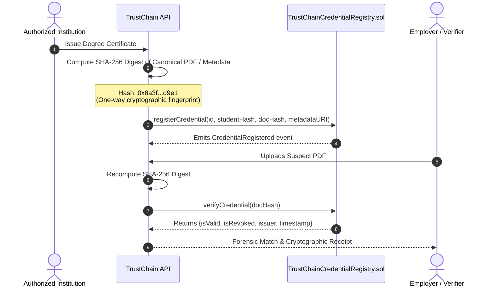

# Blockchain Credential Registry & Ledger Architecture

## 1. Overview & Problem Statement

Centralized databases are vulnerable to insider manipulation, unauthorized backdating, SQL injection breaches, and single-point-of-failure outages. **TrustChain AI** establishes decentralized proof of authenticity through the Ethereum (Sepolia testnet) blockchain.

The core smart contract, `TrustChainCredentialRegistry.sol`, functions as an immutable, tamper-resistant digital notary.

---

## 2. Zero-PII Cryptographic Anchoring

Storing student names, grades, roll numbers, or personal identifying information on an immutable public blockchain violates international privacy frameworks (GDPR Article 17 "Right to be Forgotten", FERPA).

**TrustChain AI solves this via the Zero-PII Hash Model:**

### On-Chain vs. Off-Chain Data Separation:
- **On-Chain**: Document Hash (`bytes32`), Student Hash (`bytes32`), Issuer Ethereum Address (`address`), Issuance Timestamp (`uint256`), Revocation Flag (`bool`).
- **Off-Chain**: Student Name, Coursework, Letter Grades, Signatures, High-Resolution PDF files.

---

## 3. Cryptographic Hashing Algorithms

1. **Document Integrity Hash**: Standard SHA-256 algorithm evaluated over canonicalized file byte streams:
   $$\text{Hash}_{\text{doc}} = \text{SHA256}(\text{bytes})$$
2. **Student Identity Hash**: Salted Keccak-256 hash preventing rainbow-table deanonymization:
   $$\text{Hash}_{\text{student}} = \text{keccak256}(\text{Student ID} \mathbin{\Vert} \text{Salt})$$

---

## 4. Multi-Role Access Control & Governance

- `DEFAULT_ADMIN_ROLE`: Oversees registry deployment, platform upgrades, and manages authorized issuer credentials.
- `ISSUER_ROLE`: Granted exclusively to vetted educational institutions, state boards, and training organizations. Issuers can only register credentials under their own authority.
- `REVOCATION_AUTHORITY`: Issuers can revoke their own issued credentials in the event of academic dishonesty or administrative errors, logging an immutable audit event on-chain.

---

## 5. Gas Optimization Strategies

- **Packed Struct Storage**: `uint64 timestamp` and `bool isRevoked` packed into adjacent memory slots to minimize SSTORE gas overhead.
- **Bytes32 over Strings**: Document hashes are represented as fixed `bytes32` rather than arbitrary `string` types, saving over 40% gas during registration loops.
- **View Functions for Verification**: All verifier query operations (`verifyCredential`, `getCredential`) are marked as `external view`, incurring **zero gas fees** for verifiers.

