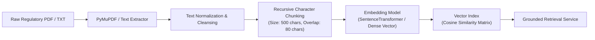

# Retrieval-Augmented Generation (RAG) Architecture & Implementation

## 1. Overview & Purpose

The **TrustChain AI RAG Engine** grounds the platform's AI Assistant in official, immutable institutional and regulatory documentation. Rather than generating ungrounded answers prone to hallucinations, the system retrieves verified clauses from university accreditation policies, state boards of education guidelines, and institutional verification standards before formatting an answer.

---

## 2. Ingestion & Chunking Pipeline

### 2.1 Chunking Strategy & Parameter Rationale
- **Chunk Size (`500 characters`)**: Matches the natural paragraph length of university examination regulations and certificate validation clauses.
- **Overlap (`80 characters`)**: Prevents boundary truncation of critical legal and institutional terminology (e.g., "degrees issued prior to June 2021 are subject to manual registrar attestation").
- **Metadata Tagging**: Each chunk is indexed with `source_id`, `source_title`, `institution`, `category`, and `chunk_index`.

---

## 3. Embedding & Retrieval Architecture

- **Embedding Model**: `all-MiniLM-L6-v2` (384-dimensional dense vectors) with high-efficiency fallback hash embeddings for restricted environments.
- **Similarity Metric**: Normalized Cosine Similarity:
  $$\text{sim}(\mathbf{q}, \mathbf{d}) = \frac{\mathbf{q} \cdot \mathbf{d}}{\|\mathbf{q}\| \|\mathbf{d}\|}$$
- **Top-K Retrieval**: Returns top 3-5 relevant chunks with minimum similarity threshold cutoff ($\tau = 0.25$) to filter out irrelevant noise.

---

## 4. Grounding & Anti-Hallucination Guardrails

To prevent hallucination in credential verification disputes:
1. **Evidence Sufficiency Classification**:
   - `HIGH`: Top similarity score $\ge 0.65$ with multiple reinforcing chunks.
   - `MODERATE`: Top similarity score between $0.35$ and $0.65$.
   - `INSUFFICIENT`: Top similarity score $< 0.35$.
2. **Mandatory Source Citations**:
   - Every claim returned by the AI Assistant must reference an explicit chunk identifier and document source title.
   - If the retrieved context does not contain sufficient facts to answer the user's question, the assistant explicitly states:
     > *"Based on the trusted knowledge base documents provided, there is insufficient evidence to confirm this rule. Please consult the registrar directly."*
3. **Responsible Verification Language**:
   - The assistant avoids definitive declarations such as *"100% Genuine"* or *"Proven Fake"*, framing all findings as evidence-based risk assessments (e.g., *"Low Risk"*, *"Elevated Risk"*, *"Requires Manual Review"*).

---

## 5. API Endpoints

- `POST /api/v1/rag/sources/upload`: Ingest verified regulatory documents (Admin/Institution only).
- `GET /api/v1/rag/sources`: List indexed knowledge base sources and chunk metrics.
- `DELETE /api/v1/rag/sources/{source_id}`: Remove or deactivate outdated sources.
- `POST /api/v1/rag/chat`: Execute context-grounded conversational queries with optional document attachment binding (`document_id`).

