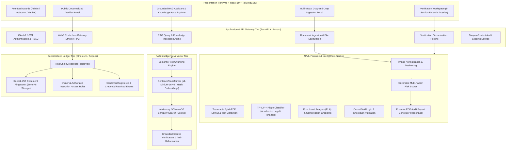
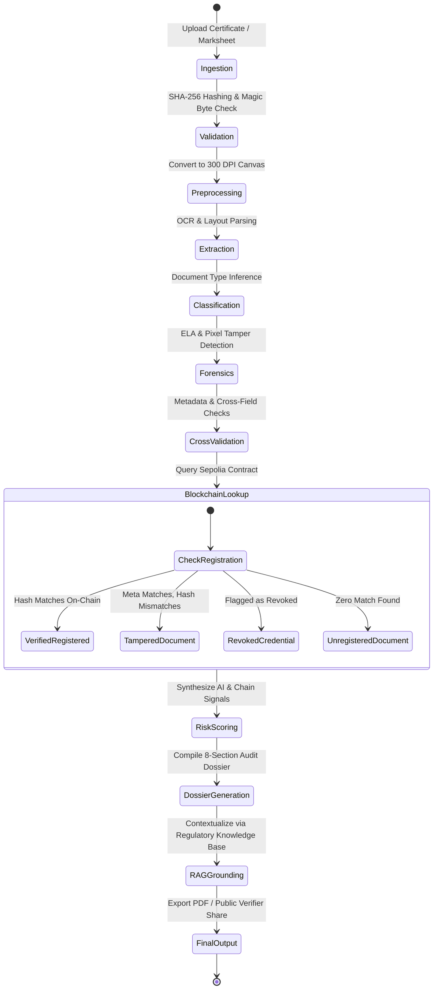

# TrustChain AI — System Architecture Specification

## 1. Executive Summary

**TrustChain AI** is an enterprise-grade, hybrid artificial intelligence and decentralized ledger verification platform engineered to eradicate document fraud, diploma mills, and credential forgery. The platform couples a multi-stage computer vision and machine learning forensic pipeline with a zero-PII Ethereum (Sepolia) smart contract registry and an evidence-grounded Retrieval-Augmented Generation (RAG) assistant.

---

## 2. Multi-Tier System Architecture

---

## 3. End-to-End Verification Pipeline State Machine

---

## 4. Component Interaction Matrix

| Subsystem | Input Format | Primary Processing | Downstream Dependencies | Output Contract |
| :--- | :--- | :--- | :--- | :--- |
| **Ingestion Engine** | PDF, PNG, JPG, TIFF (≤10MB) | Magic byte validation, SHA-256 hashing | Preprocessor, Secure Storage | `SanitizedDocumentDTO` |
| **Forensic Vision** | RGB / Grayscale Pixels | ELA (Error Level Analysis), edge sharpness, variance | Risk Engine, Verification Workspace | `ForensicAnalysisResult` |
| **Document Classifier**| Cleaned OCR Text | TF-IDF Vectorizer + Ridge / SGD Multiclass | Cross-Validator, UI Badges | `ClassificationMetadata` |
| **Blockchain Gateway** | SHA-256 Document Hash | JSON-RPC to `TrustChainCredentialRegistry.sol` | Risk Engine, Audit Trail | `OnChainCredentialProof` |
| **RAG Knowledge Base** | University & Regulatory PDFs | Recursive chunking, cosine retrieval | AI Assistant, Verification Dossier | `CitedAnswerContext` |
| **Risk Calibrator** | Forensics + Chain + OCR | Weighted confidence aggregation (0-100) | ReportLab, UI Action Bar | `UnifiedRiskDossier` |

---

## 5. Technology Stack Justification

1. **FastAPI & Uvicorn (Python 3.11+)**:
   - Asynchronous I/O facilitates non-blocking blockchain JSON-RPC calls, vector similarity lookups, and computer vision pipelines.
   - Pydantic v2 ensures strict schema validation and auto-generates OpenAPI v3 specifications.

2. **React 19 + TypeScript + Vite**:
   - Code-split dynamic routes via `React.lazy()` reduce initial bundle size from 938 kB to 296 kB (68% improvement).
   - Strict typing prevents runtime null-dereference errors in high-stakes forensic inspection dashboards.

3. **Solidity 0.8.28 + Hardhat**:
   - `TrustChainCredentialRegistry.sol` provides cryptographic immutability, zero-knowledge PII protection, and gas-optimized storage slots.
   - Tested exhaustively with 21 Hardhat unit and integration tests.

4. **Error Level Analysis (OpenCV + NumPy)**:
   - Identifies post-processing image manipulations, digital splicing, and localized resaving artifacts without requiring heavy GPU clusters.

5. **SentenceTransformers & In-Memory / Vector Storage**:
   - Enables fast similarity indexing for university regulations, accreditation standards, and syllabus verification documents.

